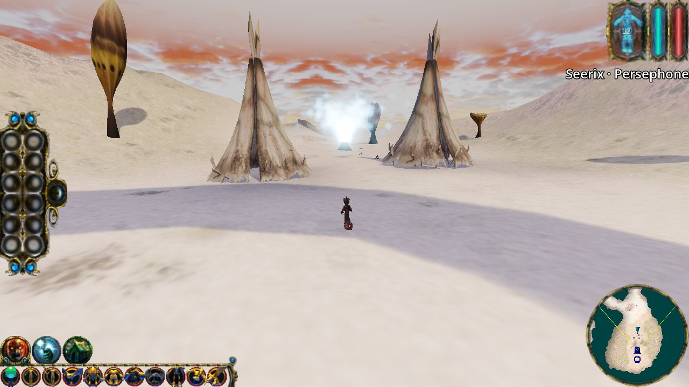
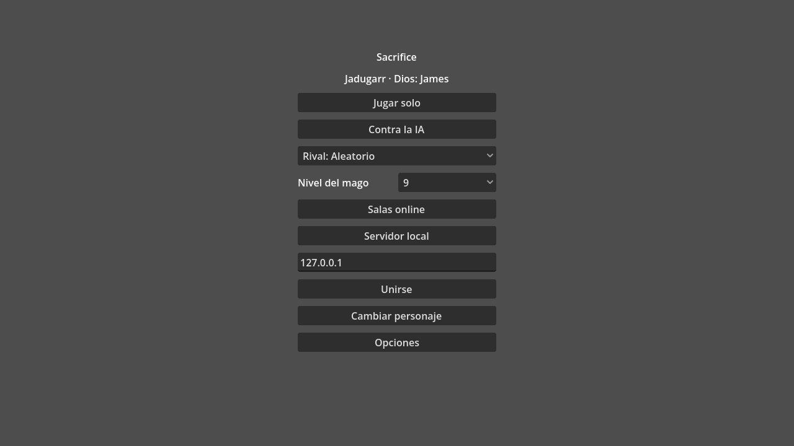
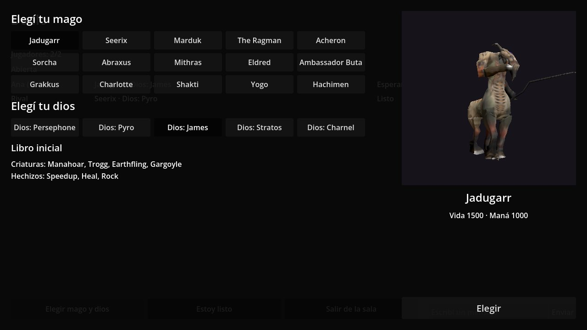
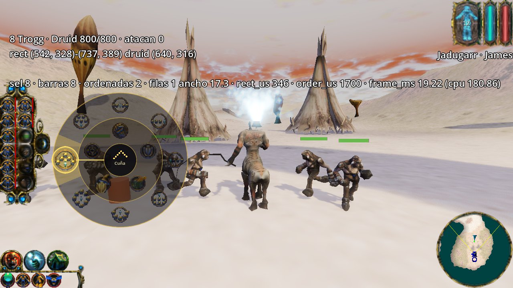
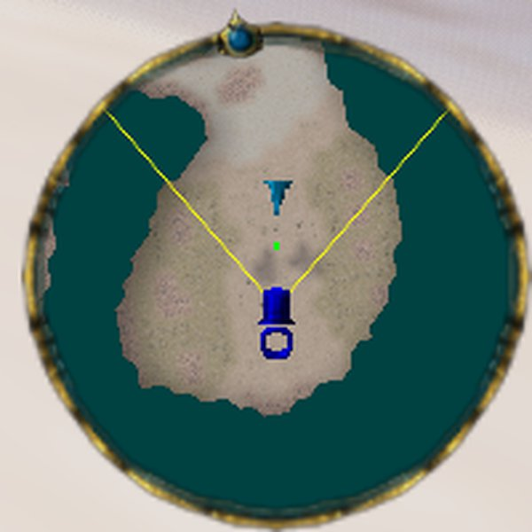

**English** | [Español](README.es.md)

# Sacrifice — a Godot 4 port

An unofficial, fan-made port of **Sacrifice** (Shiny Entertainment, 2000) to **Godot 4.7**. The goal is to play against the AI and online as in the original, with the whole game editable from the Godot editor: map, creatures, spells, animations and effects.

> **Legal notice.** This project is not affiliated with Interplay, Shiny Entertainment or the current owners of Sacrifice. The models, textures, maps and interface in `game/assets/original/` come from the original game and belong to their owners. The port's code is independent: [sacengine](https://github.com/tg-2/sacengine) (GPL) was used only as a reading reference and no code was copied.

> **Language of the game.** The in-game interface is in Spanish. This README quotes menu labels as they appear on screen, with an English gloss.



## What's there today

- **A full match against the AI** on High Noon. There are 15 wizards and 5 gods (Persephone, Pyro, James, Stratos and Charnel), each with its biome and its book of creatures and spells. The AI plays by the same rules as the player, without cheating.
- **Living villages:** 26 villagers, 6 taurocks and 69 buildings. Souls are collected and sacrificed at the altar.
- **71 creatures** with skeletons and animations, **53 spells**, Manalith, teleport and structures.
- **The original's interface:** spell book, selection panel, cursors and icons.
- **A minimap** that turns with the camera and has a compass. A right click on the minimap gives an order.
- **The original's sound:** 3D effects, creature, wizard and advisor voices, music per god (calm, battle, sacrifice, victory) and ambience, with per-bus volume in «Opciones → Sonido» (Options → Sound). Your own sounds go in `game/assets/custom/sounds/` (see `game/docs/HOWTO.en.md`).
- **A radial order menu and 8 formations.** Hold the right button, pick the formation and release: the units go there in that formation.
- **Server-authoritative multiplayer:**
  - «Salas online» (Online rooms): a player hosts the room from their PC and friends join with its code, through a relay;
  - «Servidor local» (Local server) to play from your PC without a VPS;
  - ENet or WebSocket transport;
  - reconnecting to the match with the same ticket.

| Menu | Pick a wizard and a god |
|---|---|
|  |  |

| Radial menu and formations | Minimap |
|---|---|
|  |  |

## Clone and play

**Requirements**
- [Godot 4.7.2](https://godotengine.org/download) (standard; .NET is not needed).
- [Git LFS](https://git-lfs.com). The assets go through LFS (about 190 MB). **Without LFS, the game does not load.**

```bash
git lfs install
git clone https://github.com/Joelnicolass/sacproject.git
```

If you already cloned without LFS, go into the folder and fetch the assets:

```bash
git lfs pull
```

**First time:** open `game/project.godot` with Godot and wait for the import; it takes a few minutes. Then press F5 to play. From the terminal:

```bash
godot --path game --import
```

```bash
godot --path game
```

In the menu: **Cambiar personaje** (Change character) to pick a wizard and a god, and **Jugar solo** (Play alone) or **Contra la IA** (Against the AI).

**Playing does NOT need the original game installed:** the models, textures, maps and interface are already in `game/assets/original/` (through LFS). The original is only needed for the tools that re-import from it (see [Tools that need the original game](game/docs/HOWTO.en.md#tools-that-need-the-original-game)).

### Main controls

| Action | Key |
|---|---|
| Move and turn the wizard | `W` `A` `S` `D` or the arrows |
| Select / selection box | left click / drag |
| Order (move, attack, escort) | right click |
| Radial menu of orders and formations | hold right click or `Tab` |
| Direct formation | `Alt+1` … `Alt+8` |
| Attack / guard / retreat | `Ctrl+R` / `Ctrl+A` / `Ctrl+Space` |
| Groups | `Ctrl+1…0` sets, `1…0` picks |
| Summon creatures and cast spells | the keys the book shows on screen |
| Zoom | wheel (over the minimap, it zooms the minimap) |
| Show or hide the minimap | `M` |
| Pause | `Esc` |

## For developers

| Read | For |
|---|---|
| [`game/docs/architecture.md`](game/docs/architecture.md) | Where to start: the main scenes, the autoloads, the life of a match, the network |
| [`game/CONTRIBUTING.md`](game/CONTRIBUTING.md) | How code is written, and the format, lint and test commands (§9) |
| [`game/docs/HOWTO.en.md`](game/docs/HOWTO.en.md) | Recipes: a creature, a spell, a map, your own sounds, the tools that need the original game and how to point them at it |
| [`game/docs/servidor_local.en.md`](game/docs/servidor_local.en.md) | Hosting a «Servidor local» (Local server) match |
| [`game/docs/archive/`](game/docs/archive/README.md) | Historical design records; they do not describe the current code |

```
game/
  scenes/   the game, one folder per system (units, spells, wizards, match, ui, net…)
  data/     .tres resources edited in the inspector (catalog, gods, AI, effects, rules)
  assets/   art and sound; assets/original/ comes from the original game (LFS)
  addons/   mp_kit (network), fsm_kit (state machines), agent_kit (captures), gut (tests), editor plugins
  tools/    importers, bakers, audits and lint; the game never loads them
  test/     GUT unit tests
```

The port reads the original's rules and numbers from [sacengine](https://github.com/tg-2/sacengine) and the original executable, and builds everything else on standard Godot: scenes and nodes, `.tres` resources, navmesh, `AnimationTree`, state machines and a server-authoritative network. It was built with a studio of AI agents; the skills and agents are in [godot-studio-skills](https://github.com/Joelnicolass/godot-studio-skills). Copilot copies of them live in `.github/skills/`, `skills/` and `commands/` (regenerate with `./scripts/sync-vscode-prompts.sh`).

**Coming up:** a web port on the `web-port` branch (browser client with WebRTC), grass and visual improvements.
